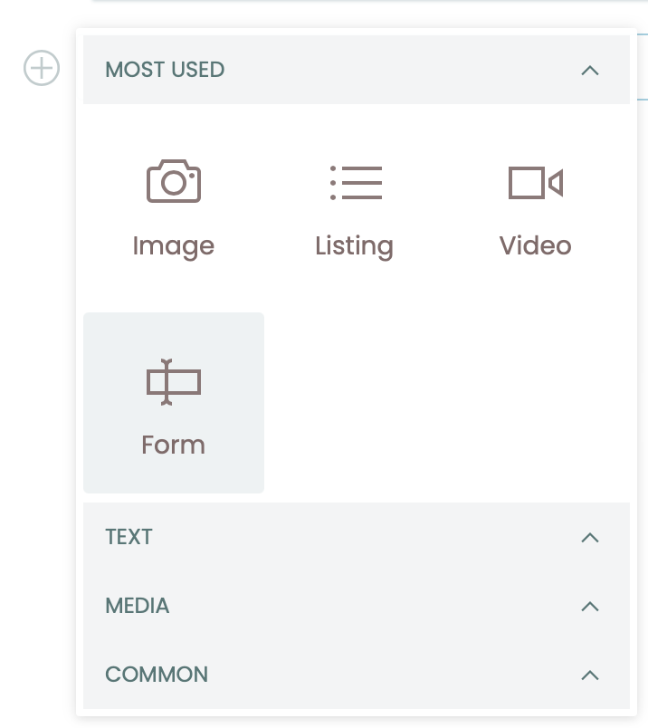
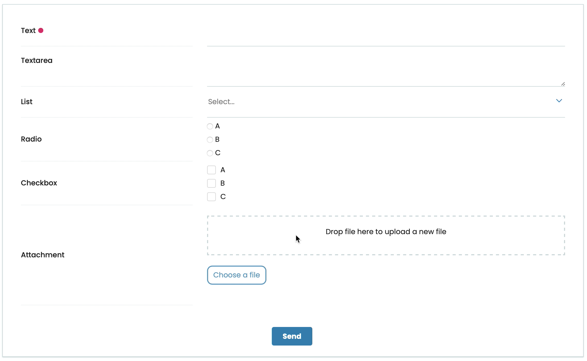
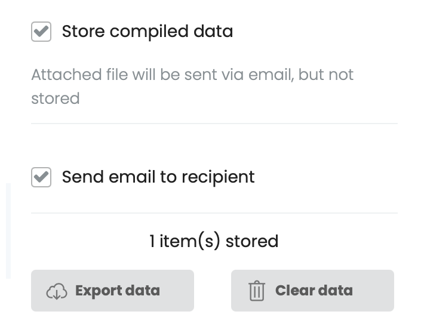
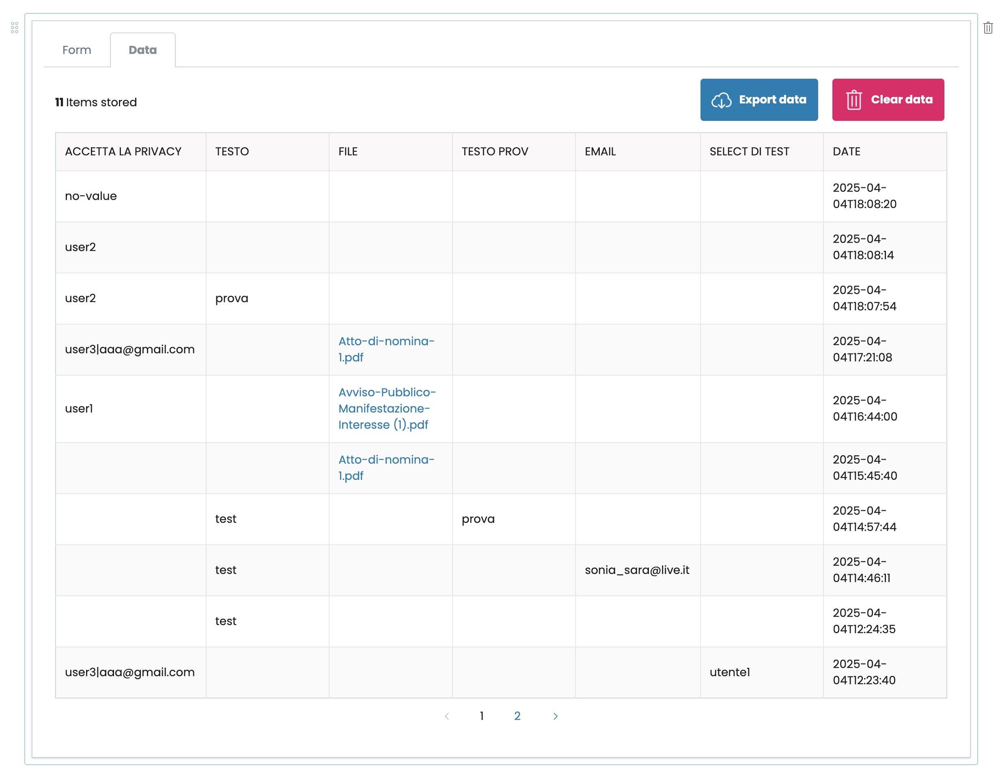
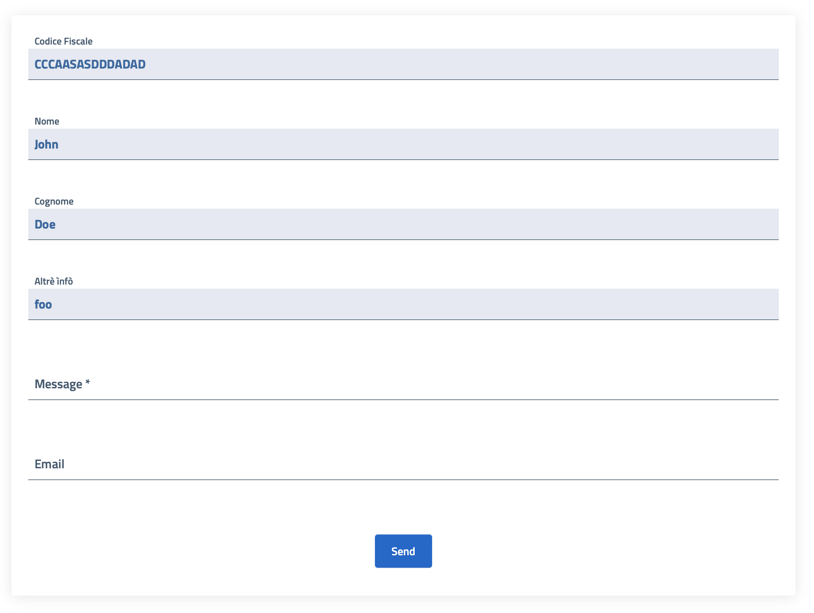

# Volto Form Block (volto-form-block)

Volto addon which adds a customizable form using a block.
Intended to be used with [collective.volto.formsupport](https://github.com/collective/collective.volto.formsupport).

[](https://www.npmjs.com/package/volto-form-block)
[](https://collective.github.io/volto-form-block/)
[](https://github.com/collective/volto-form-block/actions/workflows/main.yml)

## Features

This addon will add in your project the Form block and the needed reducers.





Using the engine of sub-blocks, you can manage form fields by adding, sorting, and deleting items.

For each field, you can select the field type from:

- Text
- Textarea
- Select
- Single choice (radio buttons)
- Multiple choice (checkbox buttons)
- Checkbox
- Date picker
- File upload with DnD
- E-mail
- Static rich text (not a fillable field, just text to display between other fields)

For every field you can set a label and a help text.
For select, radio and checkbox fields, you can select a list of values.

## Installation

This add-on requires the [`collective.volto.formsupport`](https://github.com/collective/collective.volto.formsupport) backend add-on installed in your Plone site.

Install with [mrs-developer](https://docs.voltocms.com/customizing/add-ons/) or with the method appropriate to your version of Volto.

> [!NOTE]
> - Since version v2.0.0 of this add-on, [`collective.volto.formsupport`](https://github.com/collective/collective.volto.formsupport) 2.0.0 or later and performing its upgrade steps is required.
> - Since version v2.1.2 of this add-on, Volto 14.2.0 or later is required.
> - Since version v3.0.0 of this add-on, Volto 16.0.0-alpha.38 or later is required.
> - Since version v3.11.0 of this add-on, [`collective.volto.formsupport`](https://github.com/collective/collective.volto.formsupport) 3.1.4 or later is required.
> - Since version v3.13.0 of this add-on, [`collective.volto.formsupport`](https://github.com/collective/collective.volto.formsupport) 3.3.0 or later is required.

### Volto 18 and later

Add `volto-form-block` to your `package.json`:

```json
"dependencies": {
    "volto-form-block": "*"
}
```

Add `volto-form-block` to your `volto.config.js`:

```javascript
const addons = ['volto-form-block'];
```

If this package provides a Volto theme, and you want to activate it, then add the following to your `volto.config.js`:

```javascript
const theme = 'volto-form-block';
```

### Volto 17 and earlier

Create a new Volto project (you can skip this step if you already have one):

```
npm install -g yo @plone/generator-volto
yo @plone/volto my-volto-project --addon volto-form-block
cd my-volto-project
```

Add `volto-form-block` to your package.json:

```JSON
"addons": [
    "volto-form-block"
],

"dependencies": {
    "volto-form-block": "*"
}
```

Alternatively, install it with:

```bash
yarn add volto-form-block volto-subblocks
```

Download and install the new add-on by running:

```
yarn install
```

Start volto with:

```
yarn start
```

## Test installation

Visit http://localhost:3000/ in a browser, login, add a Form block to a page, and check the new features.

## Captcha verification

This form addon is configured to work with [HCaptcha](https://www.hcaptcha.com), [ReCaptcha](https://www.google.com/recaptcha/) and
[NoRobot](https://github.com/collective/collective.z3cform.norobots) to prevent spam.

In order to make one of these integrations work, you need to add
[plone.formwidget.hcaptcha](https://github.com/plone/plone.formwidget.hcaptcha) and/or
[plone.formwidget.recaptcha](https://github.com/plone/plone.formwidget.recaptcha) and/or
[collective.z3cform.norobots](https://github.com/collective/collective.z3cform.norobots)
Plone addon and configure public and private keys in the control panels.

### HCaptcha

With HCaptcha integration, you also have an additional option in the sidebar in 'Captcha provider' to enable or disable the invisible captcha (see implications [here](https://docs.hcaptcha.com/faq#do-i-need-to-display-anything-on-the-page-when-using-hcaptcha-in-invisible-mode)).

In some test scenarios it's found that the "Passing Threshold" of HCaptcha must be configured as "Auto" to get the best results. In some test cases if one sets the Threshold to "Moderate" HCaptcha starts to fail.

### OTP email validation

To prevent sending spam emails to users via the email address configured as sender, the 'email' fields type flagged as BCC will require the user to enter an OTP code received at the address entered in the field when user fills out the form.

## Export

With backend support, you can store data submitted from the form.
In Edit, you can export and clear stored data from the sidebar.



In the most recent versions of the form, a table has been introduced for consulting the saved data.


## Additional fields

In addition to the fields described above, you can add any field you want.
If you need a field that is not supported, PRs are always welcome, but if you have to use a custom field tailored on your project needs, then you can add additional custom fields.

```jsx
config.blocks.blocksConfig.form.additionalFields.push({
  id: 'field type id',
  label:
    intl.formatMessage(messages.customFieldLabel) ||
    'Label for field type select, translation obj or string',
  component: MyCustomWidget,
  isValid: (formData, name) => true,
});
```

The widget component should have the following firm:

```js
({
  id,
  name,
  title,
  description,
  required,
  onChange,
  value,
  isDisabled,
  invalid,
}) => ReactElement;
```

You should also pass a function to validate your field's data.
The `isValid` function accepts `formData` (the whole form data) and the name of the field, thus you can access to your fields' data as `formData[name]` but you also have access to other fields.

`isValid` has the firm:

```js
(formData, name) => boolean;
```

Example custom field [here](https://gist.github.com/nzambello/30949078616328e6ee0293e5b302bb40).

## Static fields

In backend integration, you can add in block data an object called `static_fields` and the form block will show those in form view as readonly and will aggregate those with user compiled data.

i.e.: aggregated data from user federated authentication:



## Schema validators

If you want to validate configuration field (for example, testing if 'From email' is an address of a specific domain), you could add your validation functions to block config:

```js
config.blocks.blocksConfig.form = {
  ...config.blocks.blocksConfig.form,
  schemaValidators: {
    fieldname: yourValidationFN(data),
  },
};
```

`yourValidationFN` have to return:

- null if field is valid
- a string with the error message if field is invalid.

## Upgrade guide

To upgrade to version 2.4.0 you need to:

- Remove the env vars
- Install [plone.formwidget.hcaptcha](https://github.com/plone/plone.formwidget.hcaptcha) or [plone.formwidget.recaptcha](https://github.com/plone/plone.formwidget.recaptcha) or both in Plone.
- Insert private and public keys in Plone HCaptcha control panel and/or Plone ReCaptcha control panel.

## Video demos

- [Form usage](https://youtu.be/v5KtjEACRmI)
- [Form editing](https://youtu.be/wmTpzYBtNCQ)
- [Export stored data](https://youtu.be/3zVUaGaaVOg)

## Versions

With volto-form-block@2.5.0 you need to upgrade [collective.volto.formsupport](https://github.com/collective/collective.volto.formsupport) to version 2.4.0

## Development

The development of this add-on is done in isolation using a new approach using pnpm workspaces and latest `mrs-developer` and other Volto core improvements.
For this reason, it only works with pnpm and Volto 18 (currently in alpha).


### Prerequisites ✅

-   An [operating system](https://6.docs.plone.org/install/create-project-cookieplone.html#prerequisites-for-installation) that runs all the requirements mentioned.
-   [nvm](https://6.docs.plone.org/install/create-project-cookieplone.html#nvm)
-   [Node.js and pnpm](https://6.docs.plone.org/install/create-project.html#node-js) 22
-   [Make](https://6.docs.plone.org/install/create-project-cookieplone.html#make)
-   [Git](https://6.docs.plone.org/install/create-project-cookieplone.html#git)
-   [Docker](https://docs.docker.com/get-started/get-docker/) (optional)

### Installation 🔧

1.  Clone this repository, then change your working directory.

    ```shell
    git clone git@github.com:collective/volto-form-block.git
    cd volto-form-block
    ```

2.  Install this code base.

    ```shell
    make install
    ```


### Make convenience commands

Run `make help` to list the available commands.

```text
help                             Show this help
install                          Installs the add-on in a development environment
start                            Starts Volto, allowing reloading of the add-on during development
build                            Build a production bundle for distribution of the project with the add-on
i18n                             Sync i18n
ci-i18n                          Check if i18n is not synced
format                           Format codebase
lint                             Lint, or catch and remove problems, in code base
release                          Release the add-on on npmjs.org
release-dry-run                  Dry-run the release of the add-on on npmjs.org
test                             Run unit tests
ci-test                          Run unit tests in CI
backend-docker-start             Starts a Docker-based backend for development
storybook-start                  Start Storybook server on port 6006
storybook-build                  Build Storybook
acceptance-frontend-dev-start    Start acceptance frontend in development mode
acceptance-frontend-prod-start   Start acceptance frontend in production mode
acceptance-backend-start         Start backend acceptance server
ci-acceptance-backend-start      Start backend acceptance server in headless mode for CI
acceptance-test                  Start Cypress in interactive mode
ci-acceptance-test               Run cypress tests in headless mode for CI
```

### Development environment set up

Install package requirements.

```shell
make install
```

### Start developing

Start the backend.

```shell
make backend-docker-start
```

The Docker-based backend already installs the `collective.volto.formsupport` add-on in the `Plone` site.

In a separate terminal session, start the frontend.

```shell
make start
```

### Lint code

Run ESlint, Prettier, and Stylelint in analyze mode.

```shell
make lint
```

### Format code

Run ESlint, Prettier, and Stylelint in fix mode.

```shell
make format
```

### i18n

Extract the i18n messages to locales.

```shell
make i18n
```

### Unit tests

Run unit tests.

```shell
make test
```

### Run Cypress tests

Run each of these steps in separate terminal sessions.

In the first session, start the frontend in development mode.

```shell
make acceptance-frontend-dev-start
```

In the second session, start the backend acceptance server.

```shell
make acceptance-backend-start
```

In the third session, start the Cypress interactive test runner.

```shell
make acceptance-test
```

## License

The project is licensed under the MIT license.

## Credits and acknowledgements 🙏

Generated using [Cookieplone (2.0.2)](https://github.com/plone/cookieplone) and [cookieplone-templates (e1686d5)](https://github.com/plone/cookieplone-templates/commit/e1686d57aa4fa2d10c43b022fc3e97a66f90dbea) on 2026-11-06 23:55:15.604262. A special thanks to all contributors and supporters!
